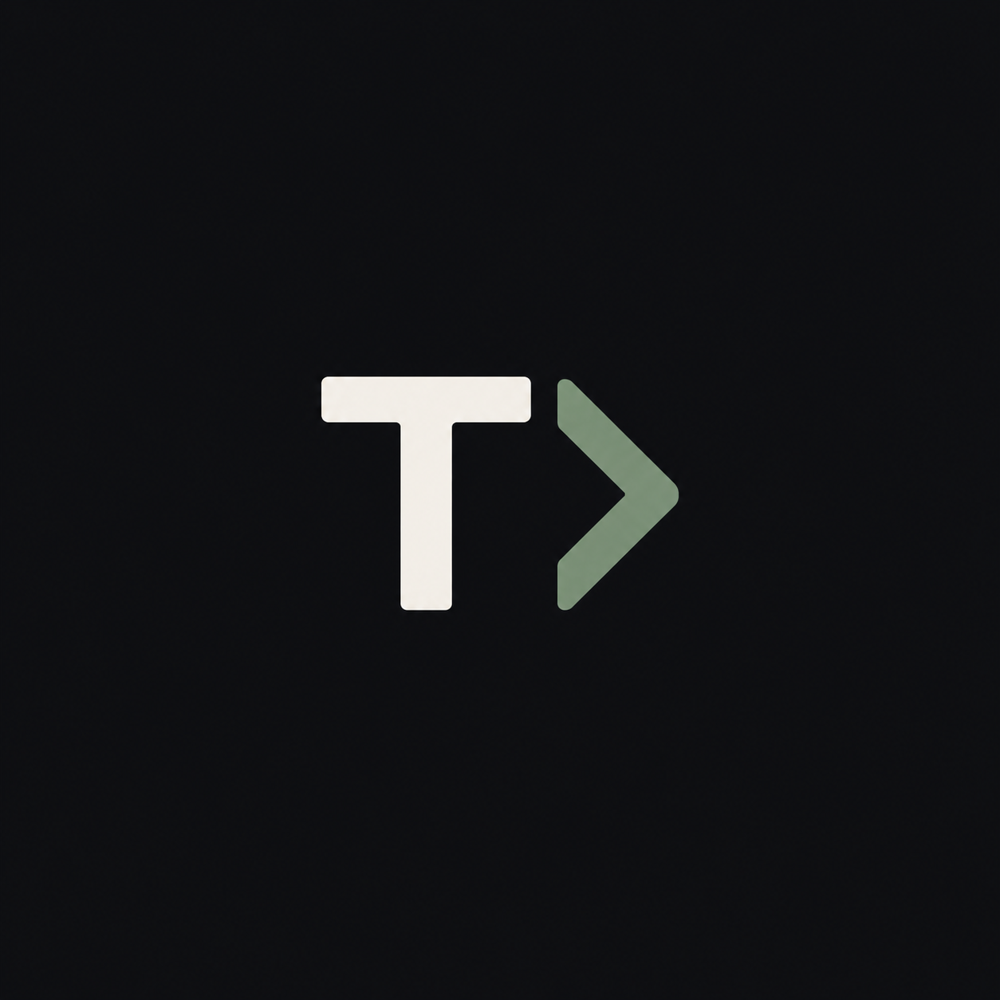

# TEXTRA

<div align="center">



**A quiet space for your thoughts.**

A minimalist, developer-inspired note-taking and writing application built for capturing ideas and organizing everyday thoughts.

</div>

---

## About

TEXTRA is a personal notes application focused on simplicity, usability, and distraction-free writing. Inspired by the understated aesthetics of developer tools and terminal environments, it aims to provide a clean workspace for everyday notes without unnecessary complexity.

Built with Python and CustomTkinter, TEXTRA is an evolving project focused on creating a lightweight, desktop-first writing experience.

## Features

- **Minimalist interface** — A clean workspace with a developer-inspired aesthetic.
- **Everyday writing** — A space for notes, ideas, and personal thoughts.
- **Desktop-first** — Built as a native desktop GUI application using Python.
- **In development** — An evolving project with room for new features and improvements.

## Tech Stack

| Technology | Purpose |
|---|---|
| Python | Core application logic |
| Tkinter | Desktop GUI foundation |
| CustomTkinter | Modernized interface components |

## Getting Started

### Prerequisites

- Python 3.10 or newer
- pip

### Installation

1. Clone the repository:

   ```bash
   git clone https://github.com/YOUR_USERNAME/textra.git
   cd textra
   ```

2. Create and activate a virtual environment:

   **Windows**

   ```powershell
   python -m venv .venv
   .venv\Scripts\Activate.ps1
   ```

   **Linux / macOS**

   ```bash
   python3 -m venv .venv
   source .venv/bin/activate
   ```

3. Install the dependency:

   ```bash
   pip install customtkinter
   ```

4. Run the application using your project's entry point. For example:

   ```bash
   python main.py
   ```

   Replace `main.py` with the actual entry-point filename if it differs.

## Project Status

TEXTRA is currently under development. Features, interface design, and internal architecture may change as the project evolves.

## Philosophy

> Write simply. Think clearly. Keep building.

TEXTRA is an exploration of building useful software with intention: keeping the interface focused, the experience approachable, and the implementation understandable.

## License

No license has been specified yet. All rights are reserved by default until a license is added to the repository.
